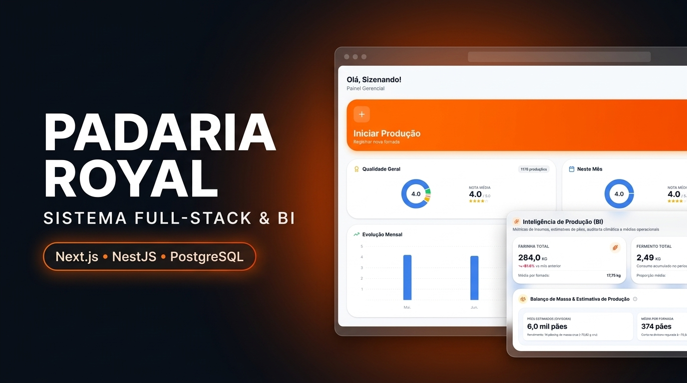

<div align="center">



<br />

# Padaria Royal — Gestão Industrial de Produção, Qualidade & BI

**Sistema web full-stack para controle de fornadas, auditoria sensorial, predição de insumos via algoritmo K-NN e inteligência de produção (BI) aplicada à panificação.**

[](https://sizenando-f.github.io/padaria-royal/)


</div>

---

## Visão Geral

O **Padaria Royal** é uma plataforma industrial desenvolvida para digitalizar e otimizar o chão de fábrica de panificação. O sistema substitui controles manuais e empíricos por um fluxo orientado a dados:

1. **Registro de Fornada (Natural ou Câmara Fria):** O padeiro registra os insumos (farinha, fermento, emulsificante), horários de início/fim e condições térmicas — preenchidas automaticamente via integração meteorológica ou por *preset* padronizado quando utilizada a câmara fria controlada.
2. **Avaliação Sensorial (Controle de Qualidade):** Após o forneamento, a produção é avaliada em uma escala de `1` (Péssimo) a `5` (Excelente), registrando a temperatura final real do ambiente e observações técnicas.
3. **Retroalimentação Preditiva e Analítica:** As fornadas validadas retroalimentam em tempo real tanto o **motor K-NN de sugestão de fermento** quanto o painel de **Business Intelligence (BI Gerencial)**, permitindo auditar perdas térmicas, eficiência de dosagem por faixa climática e projeção mensal de consumo de trigo.

> **Especificação Completa:** Consulte a [**Documentação Técnica & Arquitetura v2.0**](https://sizenando-f.github.io/padaria-royal/) para explorar todos os 21 endpoints REST, diagramas de fluxo, schemas do banco e fórmulas matemáticas detalhadas.

---

## Funcionalidades Principais

### Motor Preditivo de Fermento (K-NN Ponderado)
Recomenda a dosagem ideal de fermento (em gramas) para a batida atual com base nos **20 vizinhos históricos mais próximos ($K = 20$)** de alta qualidade (`nota ≥ 4`), ponderando temperatura inicial, temperatura final prevista e tempo de fermentação. Devolve também as **5 fornadas mais similares** como evidência transparente para o operador.

### Controle e Isolamento de Câmara Fria (`usouCamara`)
- **Preset Inteligente no Chão de Fábrica:** Ao ativar a chave *Câmara Fria* no formulário mobile-first, o sistema preenche instantaneamente os parâmetros padrão da câmara (`18:00` às `02:00`, `8h` de fermentação, `6°C` inicial, `30°C` final, `20 kg` de farinha, `110 g` de fermento e `80 ml` de emulsificante), mantendo os campos editáveis e bloqueando o botão de sugestão climática.
- **Sanitização Matemática:** Produções de câmara fria são estritamente isoladas (`usouCamara: false`) do espaço de busca do K-NN e da Auditoria Climática, impedindo que a receita fixa de ambiente fechado contamine a predição das fornadas em armário aberto.
- **Detecção Híbrida via Regex:** Mesmo que o operador esqueça de marcar o switch, o backend inspeciona os campos de `observacoes`, `comentario` da avaliação e planilhas CSV importadas para identificar menções textuais (*"câmara fria"*, *"camara"*, *"câmera"*) e classificar o registro automaticamente.

### Business Intelligence (BI Gerencial)
Módulo analítico exclusivo para gerentes (`GET /producao/bi-stats`), estruturado em quatro pilares:
- **Balanço de Massa Físico (3 Óticas):** Calcula a estimativa exata de pães produzidos a partir da receita base industrial (`40 kg` farinha + `20 kg` água + `0,2 kg` aditivos = `60,2 kg` massa crua $\rightarrow$ `46,75 kg` pão assado):
  1. *Por Farinha:* Rendimento direto de **$21,25\text{ pães/kg}$** de trigo.
  2. *Por Massa Crua (Divisora):* Fator de hidratação de **$1,505\times$** sobre a farinha (**$14\text{ pães/kg}$** de massa a $\sim 71\text{g}$).
  3. *Por Pão Assado (Balcão):* Fator de **$1,16875\times$** (**$18\text{ pães/kg}$** assados de $55\text{g}$), contabilizando a **quebra térmica de cocção de $22,3\%$** (evaporação no forno).
- **Auditoria Climática de Dosagem (Zona de Ouro $\pm 10\%$):** Segmenta o histórico em **Frio ($< 20^\circ\text{C}$)**, **Ameno ($20^\circ\text{C}\text{–}26^\circ\text{C}$)** e **Quente ($> 26^\circ\text{C}$)**, extrai a proporção ideal ($\text{g/kg}$) das fornadas Nota 5 (com *fallback* automático para a referência histórica global caso o mês atual ainda não possua amostras na faixa) e mede a taxa de aderência da equipe.
- **Sensibilidade e Estabilidade Térmica ($\Delta T$):** Compara a nota média e a taxa de excelência entre fornadas em **Ambiente Estável ($\Delta T \le 4^\circ\text{C}$)** e fornadas sob **Alta Oscilação ($\Delta T > 4^\circ\text{C}$)**.
- **Projeção Mensal de Consumo (*Run-Rate*):** Projeta o fechamento de consumo de farinha em quilos/toneladas no mês corrente com base no ritmo diário acumulado e variação *Month-over-Month (MoM)*.

### Previsão Meteorológica com Fallback Híbrido
Integração com a API **Open-Meteo** para preenchimento automático da temperatura inicial e final prevista. Possui arquitetura de **dupla resiliência**: caso o IP compartilhado do servidor em nuvem sofra *rate-limiting*, o frontend executa automaticamente um *fallback client-side* direto do navegador do operador.

### Governança, Segurança e Automação
- **RBAC Granular e Janela Temporal:** Dois cargos (`GERENTE` e `PADEIRO`) com 5 permissões booleanas independentes no payload JWT (`registrar`, `avaliar`, `historico`, `editar`, `excluir`), bloqueio de login fora do turno cadastrado e trava de edição de **3 dias** para padeiros.
- **Backup Diário Resiliente (Resend API):** Tarefa agendada (`@nestjs/schedule`) executada diariamente às `19:00` (`America/Campo_Grande`) e disponível sob demanda (`POST /backup/run`), com trava de concorrência/idempotência e até **5 tentativas com *exponential backoff***.
- **Importação Assíncrona em Lotes e Auditoria:** Processamento de planilhas CSV históricas em background (lotes de 50 registros) e log imutável de exclusões (`LogExclusao`).

---

## Matemática do Algoritmo K-NN

Para responder *"quantos gramas de fermento devo usar hoje?"*, o motor executa 4 etapas em tempo real sobre as fornadas naturais (`usouCamara: false`) e bem-avaliadas (`nota ≥ 4`):

**1. Distância de Manhattan Normalizada:**
Combina desvios térmicos e diferença de tempo de fermentação (dividida por `60` para converter minutos em horas, equiparando `1h` de diferença à mesma escala de `1°C`):

$$\text{distância} = |T_{\text{ini, hist}} - T_{\text{ini, atual}}| + |T_{\text{fim, hist}} - T_{\text{fim, atual}}| + \frac{|\text{tempo}_{\text{hist}} - \text{tempo}_{\text{alvo}}|}{60}$$

**2. Seleção de Vizinhança e Ponderação Inversa:**
Selecionam-se os **$K = 20$ registros mais próximos**, atribuindo a cada vizinho um peso inversamente proporcional à distância (com constante de suavização $+0,1$ para evitar divisão por zero em cenários idênticos, onde $\text{peso}_{\max} = 10$):

$$\text{peso}_i = \frac{1}{\text{distância}_i + 0,1}$$

**3. Média Ponderada Invariante à Escala:**
Calcula-se a proporção relativa ($\text{fermento}_i \div \text{farinha}_i$) de cada vizinho, tornando a recomendação independente do tamanho da batida:

$$\text{proporção média} = \frac{\sum_{i=1}^{20} (\text{proporção}_i \times \text{peso}_i)}{\sum_{i=1}^{20} \text{peso}_i}$$

$$\text{fermento sugerido (g)} = \text{round}(\text{proporção média} \times \text{farinha atual})$$

---

## Arquitetura e Stack Tecnológica

O projeto é estruturado como um monorepo full-stack com separação estrita de responsabilidades:

```text
padaria-royal/
├── backend/       # API REST em NestJS 11 + Prisma ORM + Motor K-NN & BI
├── frontend/      # SPA Mobile-First em Next.js 16 (App Router) + React 19
├── docs/          # Portal de Documentação Técnica v2.0 (GitHub Pages)
└── docker-compose.yml
```

| Camada | Tecnologias |
| :--- | :--- |
| **Frontend** | Next.js 16 (App Router), React 19, TypeScript, Tailwind CSS 4, TanStack React Query, Recharts, Lucide React, Sonner |
| **Backend** | NestJS 11, TypeScript, Prisma ORM, JWT (`HS256`) + bcrypt, `class-validator`, `@nestjs/schedule`, Compressão HTTP Gzip |
| **Banco de Dados** | PostgreSQL 15 (Neon Serverless Postgres em produção / Docker local) |
| **Integrações** | Open-Meteo API (Híbrido Backend + Client-side), Resend API (Backup CSV transacional), `json2csv` |
| **Cloud & CI/CD** | Vercel (Frontend), Render (Backend API), Neon (Database), GitHub Pages (Docs) |
| **Testes** | Jest (Testes Unitários e Cobertura) + Supertest (E2E) |

---

## Como Executar Localmente

### Pré-requisitos
- **Node.js 20+**
- **Docker** e **Docker Compose**

### 1. Subir o banco de dados PostgreSQL
```bash
docker-compose up -d
```

### 2. Configurar e iniciar o Backend
```bash
cd backend
cp .env.example .env
npm install
npx prisma migrate deploy
npx prisma db seed
npm run start:dev
```
> A API estará disponível em `http://localhost:3000`.

### 3. Configurar e iniciar o Frontend
```bash
cd frontend
npm install
npm run dev
```
> A interface web estará disponível em `http://localhost:3001` (ou `http://localhost:3000` se executada isoladamente).

### Variáveis de Ambiente

| Variável | Escopo | Obrigatória | Descrição |
| :--- | :--- | :---: | :--- |
| `DATABASE_URL` | Backend | Sim | String de conexão PostgreSQL (Docker local ou Neon Serverless) |
| `JWT_SECRET` | Backend | Sim | Chave secreta para assinatura e verificação de tokens JWT |
| `CIDADE_LAT` | Backend | Sim | Latitude da cidade para consulta meteorológica (Open-Meteo) |
| `CIDADE_LON` | Backend | Sim | Longitude da cidade |
| `RESEND_API_KEY` | Backend | Sim | Chave de API da Resend para envio do backup CSV diário |
| `EMAIL_DESTINO` | Backend | Não | E-mail destinatário de fallback caso a chave `EMAIL_BACKUP` não exista no banco |
| `IMPORT_TIMEZONE` | Backend | Não | Offset de fuso horário para importação de CSV (padrão: `-04:00`) |
| `PORT` | Backend | Não | Porta HTTP do servidor (padrão: `3000`) |
| `NEXT_PUBLIC_API_URL` | Frontend | Sim | URL base da API do backend |

---

## Testes Automatizados

```bash
cd backend
npm run test          # Executa os testes unitários
npm run test:cov      # Gera relatório de cobertura de testes
npm run test:e2e      # Executa testes End-to-End com Supertest
```

---

## Decisões de Engenharia

- **Por que K-NN Ponderado em vez de Regressão Linear?** Em processos biológicos de fermentação com forte interação entre variáveis (temperatura inicial/final e tempo), a vizinhança ponderada pela distância de Manhattan adapta-se de forma não-linear sem exigir retreinamento offline, melhora organicamente a cada nova fornada nota 4–5 e oferece **explicabilidade total** ao devolver as 5 fornadas reais que originaram o cálculo.
- **Por que Isolar a Câmara Fria (`usouCamara`)?** Como o K-NN seleciona os 20 vizinhos pela menor distância, dezenas de fornadas feitas em câmara controlada com parâmetros idênticos formariam um cluster artificial capaz de dominar a vizinhança em dias de clima ameno, distorcendo a recomendação para fermentações naturais em armário aberto.
- **Por que Fallback Híbrido na Open-Meteo?** Ambientes PaaS em nuvem compartilham faixas de IP de saída que podem sofrer bloqueio temporário (*HTTP 429*) em APIs meteorológicas públicas. O fallback automático no navegador garante disponibilidade de 100% usando a conexão local do dispositivo do operador.
